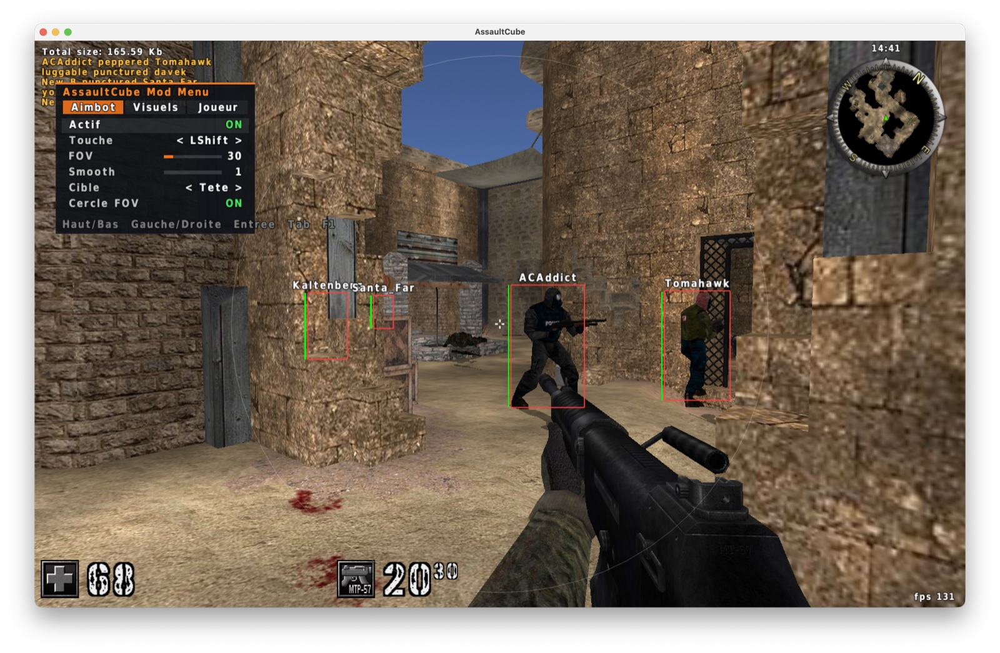
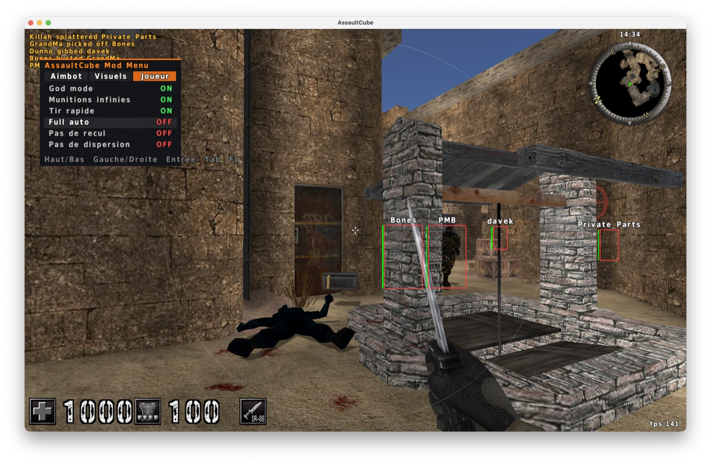
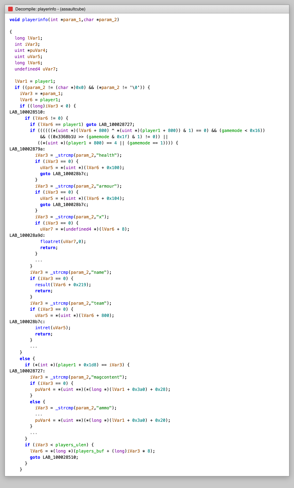
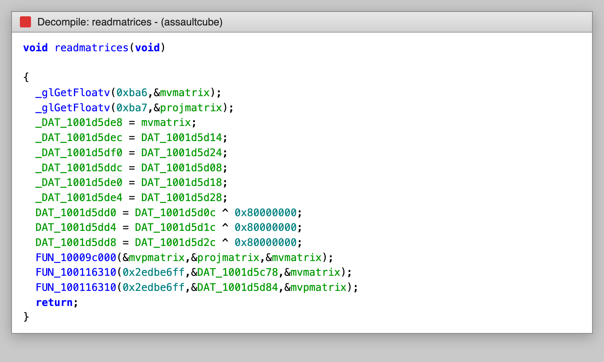
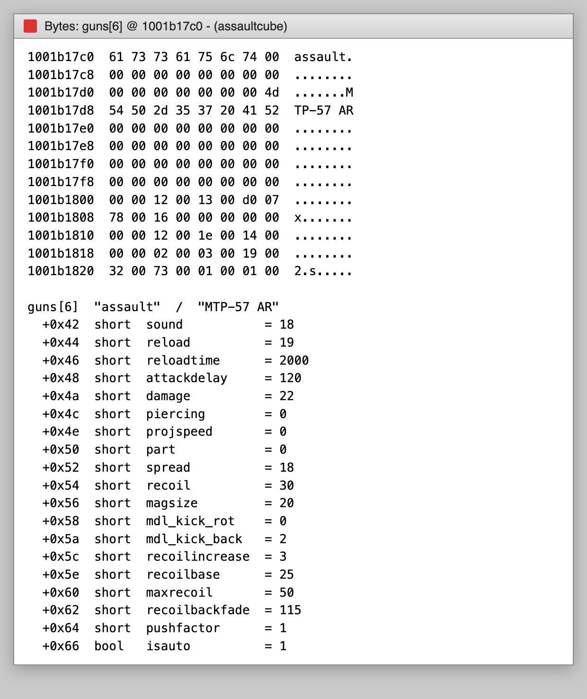

# accheat

Internal mod menu for **AssaultCube 1.3.0.2** on macOS (x86_64 build, runs under Rosetta on Apple Silicon).

Made to learn reverse engineering. Use it **offline, against bots**.




## Features

The in-game menu is in French.

| Tab | Options |
|---|---|
| Aimbot | enabled, key (LShift / right click / always), FOV, smoothing, target (head / body), FOV circle |
| Visuels | boxes, health bar, names, distance, snaplines, teammates |
| Joueur | god mode, infinite ammo, rapid fire, full auto, no recoil, no spread |

## Usage

```sh
./run.sh                                  # game in /Applications
AC_APP=~/Games/AssaultCube.app ./run.sh   # custom location
```

`run.sh` builds the dylib with `make`, then starts the game with `DYLD_INSERT_LIBRARIES`.

| Key | Action |
|---|---|
| F1 / Insert | open / close the menu |
| Up / Down | select an option |
| Left / Right | change the value |
| Enter | toggle |
| Tab | next tab |
| Esc | close the menu |

While the menu is open, keyboard and mouse input is not forwarded to the game.

## Reversing

The binary is stripped, but AssaultCube is open source. The approach: look for strings known to be in the source,
follow the xrefs in Ghidra, and match the pseudocode against the original code.

### playerinfo() at `0x1000284a0`

Found through the `"health"` string. This is the `player <cn> <attr>` script command: one `strcmp` per attribute,
then a read of the matching field. It gives most of the `playerent` layout at once.



| Field | Offset |
|---|---|
| `player1` | `0x1001cbd38` |
| `players` (buf / ulen) | `0x1001cbd40` / `0x1001cbd4c` |
| `gamemode` | `0x1001cbb84` |
| `o` (position) | `+0x08` |
| `state` | `+0x7a` |
| `health` / `armour` | `+0x100` / `+0x104` |
| `name` | `+0x219` |
| `team` | `+0x320` |
| `weaponsel` -> `ammo*` / `mag*` | `+0x3a0` -> `+0x20` / `+0x28` |

The check `gamemode < 0x16 && (0x3368b1 >> gamemode) & 1` is `m_teammode`. The ESP reuses it as is.

### Camera

The minimap renderer calls `glRotatef(camera1->roll / pitch / yaw)` then `glTranslatef(-camera1->o)`, which gives
`yaw +0x38`, `pitch +0x3c`, `roll +0x40`. With `scoping` at `+0x6a`, the rest of `physent` follows:
`eyeheight +0x54`, `aboveeye +0x5c`.

### readmatrices() at `0x10009aec0`

Calls `glGetFloatv` with `GL_MODELVIEW_MATRIX` (`0xba6`) and `GL_PROJECTION_MATRIX` (`0xba7`).
The result `mvpmatrix = proj * mv` is stored at `0x1001d5d44` and used for world to screen.



### draw_text() at `0x1000c1140`

`draw_text(str, x, y, r, g, b, a, cursor, maxwidth)`, used for all the menu and ESP text.
It reads `curfont` (`0x1001d6f00`): glyphs at `+0x10` (stride `0x14`, width is a `short`), count `+0x1c`,
space width `+0x20`, line height `+0x24`, first char `+0x38`.

### guns[] at `0x1001b1550`

Found through the model names (`knife`, `pistol`, ...). 9 entries of `0x68` bytes. The `guninfo` layout was checked
against the `assault` entry (reloadtime 2000, attackdelay 120, damage 22, magsize 20, isauto 1):



Rapid fire, full auto, no recoil and no spread edit this table. It is rebuilt every frame from a copy of the
original values, so turning an option off restores the stock stats.

The binary is PIE: every address above is shifted by `_dyld_get_image_vmaddr_slide(0)`.

## Injection

The game is neither signed nor built with the hardened runtime, so `DYLD_INSERT_LIBRARIES` is honored.
The dylib interposes `SDL_GL_SwapWindow` (logic and overlay, once per frame in the game's GL context)
and `SDL_PollEvent` (menu input) through the `__DATA,__interpose` section.

## Limitations

- Offsets only match the 1.3.0.2 macOS build. On load the dylib checks `guns[6]` and disables itself
  if it does not match.
- No visibility check: the aimbot locks through walls.
- Smoothing depends on the framerate.
